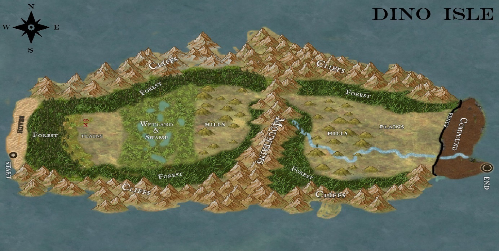

# First Look at the Map

You unfold the map and study the marked locations, hoping to find a clue about where to go next. After choosing a direction, you fold the map and tuck it away. “Alright, time to keep moving!” you say, setting off toward your next destination.

- 👉 [Make your way towards the swamp](./scene4.md)